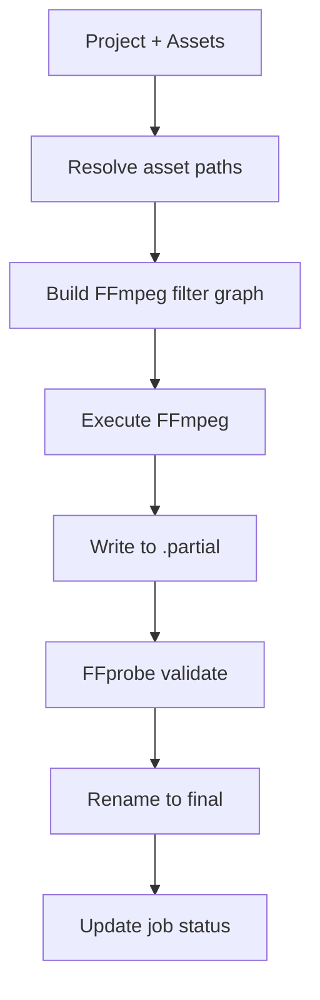

# Media Jobs and Render Plan Specification

> **Status:** Draft — Phase 8 implementation
> **Scope:** Durable job scheduler contract, render plan DTO, filter DAG, export pipeline  
> **Owner:** Rust `jobs`, `exports` modules; `packages/media-core`, `packages/contracts`

---

## 1. Job System Overview

The durable job scheduler manages background media and project work:

| Kind               | Purpose                                                                                                                 | Trigger                                                                                                 |
| ------------------ | ----------------------------------------------------------------------------------------------------------------------- | ------------------------------------------------------------------------------------------------------- |
| `prepare`          | Probe, thumbnail, waveform, and audio/video track generation for a recording; optional low-res preview proxy on request | After recording stop or recovery; proxy stage runs when the editor picks a reduced preview-quality mode |
| `asset_derivative` | Generate thumbnails, waveforms, previews, or proxies for one imported asset                                             | Asset import or relink                                                                                  |
| `camera_ai`        | Generate the portrait matte and/or face-track derivative for one camera stream (offline ONNX)                           | User runs Camera AI from the camera inspector; deterministic artifacts are cached per stream            |
| `export`           | Render timeline to final MP4                                                                                            | User initiates export                                                                                   |
| `upload`           | Send exported file to S3/Drive/local folder                                                                             | User initiates upload                                                                                   |

---

## 2. Job Schema

```jsonc
{
  "id": "job-uuid",
  "recordingId": "recording-uuid",
  "kind": "prepare", // prepare | asset_derivative | camera_ai | export | upload
  "status": "running", // pending | running | completed | failed | cancelled
  "progress": 0.45, // 0.0–1.0
  "stage": "proxy", // Current sub-stage label
  "message": "Generating proxy (45%)",
  "error": null,
  "priority": 0, // Higher = more urgent; exports > derivatives
  "attempts": 1, // Retry count
  "maxAttempts": 3,
  "restartPolicy": "retry", // retry | skip | fail
  "createdAt": "2026-01-01T00:00:00Z",
  "updatedAt": "2026-01-01T00:02:30Z",
  "startedAt": "2026-01-01T00:00:01Z",
  "completedAt": null,
  "outputs": {
    "metadataPath": "...",
    "proxyPath": "...",
    "thumbnailDir": "...",
    "thumbnailManifestPath": "...",
    "waveformPath": "...",
    "waveformImagePath": "...",
    "assetId": null,
    "derivatives": {},
  },
  "options": { "projectId": "...", "outputPath": "...", "plan": "...", "settings": "..." }, // JSON persisted in SQLite
  "cancellationToken": "in-memory AtomicBool",
}
```

---

## 3. Scheduler Requirements

### 3.1 Persistence

- Jobs MUST be persisted to SQLite before the background thread starts
- On app restart, pending/running jobs are detected and resumed
- Completed jobs are retained for history; pruned after configurable retention

### 3.2 Concurrency and throttling

| Scenario            | Max Concurrent Jobs      |
| ------------------- | ------------------------ |
| Idle (no recording) | 2 prepare + 1 export     |
| During recording    | 0 (pause all heavy jobs) |
| Low-end machine     | 1 at a time              |

### 3.3 Deduplication

Before creating a job, check if an equivalent job already exists:

- Same `recordingId` + same `kind` + status is `pending` or `running` → reuse the scheduler-owned job identity
- Export retries re-queue the failed/cancelled row and retain its id/options
- Prepare jobs may still create a new row when `force: true`

### 3.4 Cancellation

- Each job has a cancellation token (AtomicBool)
- Cancel sets the token; worker checks between stages
- Cancelled jobs clean up partial outputs
- Race condition: if a job completes between cancel request and token check, the completion wins

### 3.5 Atomic outputs

All jobs write to `.partial` files, validate, then rename to final path:

```
proxy.mp4.partial → (FFprobe validate) → proxy.mp4
```

### 3.6 Render notes (effect downgrades)

A finished export records every effect it rendered below full quality on
`outputs.renderNotes: EffectDowngrade[]` (`{ effect, reason }`, ADR 020). The
list comes from `gpu::effect_support` for the renderer that actually ran,
is persisted by `complete_job`, and surfaces in the export view as a
non-blocking notice ("Rendered with simplifications"). An empty list means the
delivered file matches the editor's full-quality preview.

---

## 4. Render Plan DTO

The render plan is the contract between the editor (TypeScript) and the export engine (Rust).

### 4.1 Current schema (from `packages/contracts/src/timeline.ts`)

The Phase 8 DTO is project-scoped and contains no source-media paths:

```typescript
interface RenderPlan {
  projectId: string
  canvas: TimelineCanvas
  durationMs: number
  segments: RenderSegment[]
  gaps: Array<{ startMs: number; endMs: number }>
  audioTracks: RenderPlanAudio[]
  overlays: RenderPlanOverlay[] // the unified video-layer list (camera + b-roll)
  cameraLayouts: RenderPlanCameraLayout[] // #5 per-frame camera/screen poses
  layerOrder: Array<{ kind: "camera" | "video"; id: string }> // middle-band draw order
  captions: RenderPlanCaption[] // each cue may carry a px-resolved `layout` the ASS writer renders verbatim
  masks: RenderPlanMask[]
  zoomSegments: RenderPlanZoomSegment[]
  cursorEffects: RenderPlanCursorEffect[]
}

interface RenderPlanZoomSegment {
  id: string
  startMs: number
  endMs: number
  target: { x: number; y: number; width: number; height: number }
  scale: number
  easing:
    "linear" | "ease-in" | "ease-out" | "ease-in-out" | "smooth" | "cinematic" | "snappy" | "spring"
  transitionInMs: number // default 400
  transitionOutMs: number // default 400
  enabled: boolean
  mode?: "auto" | "manual" | "static" | "follow-cursor" | "smooth-pan"
  source?: "click" | "dwell" | "movement" | "manual" | "follow" | "cluster"
  preset?: "subtle" | "product-demo" | "cinematic" | "developer" | "manual-only"
  followDeadzonePercent?: number
  followSmoothingAlpha?: number
  label?: string
  // Camera-shot bridging (§5.3): when a segment starts within
  // ZOOM_BRIDGE_GAP_MS of the previous one, the previous shot's end pose is
  // baked into fromTarget/fromScale so the camera pans in instead of popping
  // to 1x. followSpeed lives on the editor schema only — export consumes the
  // baked motion plan.
  fromTarget?: { x: number; y: number; width: number; height: number }
  fromScale?: number
  // Follow-camera paths: compact cubic-Bézier motion plan (v1) is preferred;
  // `keyframes` remains accepted for older plans.
  keyframes?: Array<{ timeMs: number; target: ZoomTarget }>
  motionPlan?: RenderPlanZoomMotionPlan
}

interface RenderPlanZoomMotionPlan {
  version: 1
  kind: "cubic-bezier"
  // Contiguous segments; each carries start/control1/control2/end points in
  // canvas coordinates. Evaluated by `evaluate_cubic_motion_plan` (Rust) and
  // `evaluateCubicMotionPlan` (TypeScript) with identical results.
  segments: Array<{
    startMs: number
    endMs: number
    start: { x: number; y: number }
    control1: { x: number; y: number }
    control2: { x: number; y: number }
    end: { x: number; y: number }
  }>
}

interface RenderSegment {
  assetId: string // Rust resolves project assetId → canonical path
  sourceInMs: number
  sourceOutMs: number
  outputStartMs: number
  outputEndMs: number
  speed: number
}

interface ExportTimelineOptions {
  projectId: string
  outputPath: string // validated destination, never source media
  plan: RenderPlan
  settings: ProjectExportSettings
}
```

TypeScript validates the plan and project identity before IPC. Rust validates the same ranges, effect timing, canvas, settings, and asset references before scheduling FFmpeg.

#### 4.1.1 Unified video layers, camera layouts and gaps (M3, ADR 022)

```typescript
interface RenderPlanOverlay {
  id?: string
  role?: "camera" | "video" // camera → follows cameraLayouts, video → b-roll
  assetId: string
  sourceInMs: number
  sourceOutMs: number
  outputStartMs: number
  outputEndMs: number
  speed: number
  x: number
  y: number
  width: number
  height: number
  crop?: { x: number; y: number; width: number; height: number }
  opacity: number
  visible: boolean
  shape: "rectangle" | "rounded" | "circle"
  radius?: number // corner radius in canvas px; always emitted (authoritative) for camera layers (ADR 023)
  fit?: "contain" | "cover" | "fill" // camera defaults to cover, b-roll to contain
  // Camera-frame mode (ADR 023); absent means a legacy clip resolved from
  // transform fields (Rust falls back to `preset`/0.76 geometry heuristics).
  mode?: "overlay" | "split" | "full"
  // Screen slot for `mode: "split"` — the letterboxed area the screen video
  // occupies while the camera fills the complementary side.
  screen?: { x: number; y: number; width: number; height: number }
  // Animated pose track, absolute output ms. Linear interpolation between
  // samples; a hold is two equal poses. Absent keeps the static rect.
  keyframes?: RenderPlanLayoutKeyframe[]
}

interface RenderPlanLayoutKeyframe {
  timeMs: number
  x: number
  y: number
  width: number
  height: number
  radius: number
  opacity: number
}

interface RenderPlanCameraLayout {
  id: string
  startMs: number
  endMs: number
  camera: RenderPlanLayoutKeyframe[] // camera bubble pose per frame
  screen?: RenderPlanLayoutKeyframe[] // screen pose (side-by-side slot)
}
```

- **One layer record.** Camera bubbles and b-roll / media-track video crossed the
  boundary as the same `RenderPlanOverlay` shape, so both renderers reuse one
  coalescing + decode + quad path. Layers decode at the largest rect their
  keyframes reach (capped at source size) and the compositor rewrites the quad's
  destination rect per frame.
- **Frame-backed camera layers (ADR 023).** Clips carrying `frame` emit fully
  resolved geometry: `x`/`y`/`width`/`height` and `radius` are canvas px,
  `borderWidth`/`borderOpacity`/`shadow*` style lengths are design units
  resolved to px at the plan's short edge, and `mode`/`screen` describe the
  camera slot and (for `split`) the screen slot. Rust consumes them verbatim —
  it no longer infers side-by-side from x coordinates; only plans without
  `mode` keep the legacy `preset === "side-by-side"` / 0.76 fallback.
- **Draw order.** `layerOrder` lists the middle band (camera bubbles and video
  layers) in timeline track order. Screen is pinned to the bottom and
  cursor/items/keystrokes/captions to the top.
- **Gaps (F2).** A mid-timeline gap becomes a black `color` source in the decode
  pass and sets `has_screen = false` for those frames, so the composite pass
  paints the canvas background only. A trailing gap stays a freeze-frame tail
  (`tpad=clone`). Plans with declared gaps no longer leave the GPU gate.
- **Downgrades (ADR 020).** The compatibility renderer composites video layers at
  their static rect: animated layers report `video-layer-animation` and camera
  layouts report `camera-layouts`.

#### 4.1.2 Camera AI (M4, ADR 021)

```typescript
interface RenderCameraColor {
  exposure: number; contrast: number; saturation: number
  temperature: number; tint: number
  lutId?: string       // bundled look id
  lutAssetId?: string  // project `.cube` asset id
  lutIntensity: number
}
interface RenderCameraCutout {
  background: "none" | "blur" | "color" | "image"
  blurRadius: number; color: string; imageAssetId?: string
  edgeSoftness: number; edgeShrink: number
  mattePath?: string   // absolute; Rust requires it inside the work dir
}
interface RenderCropKeyframe { timeMs: number; x: number; y: number; width: number; height: number }
// On RenderPlanOverlay (camera layers):
color?: RenderCameraColor
cutout?: RenderCameraCutout
cropKeyframes?: RenderCropKeyframe[] // face-tracked framing, ≤10 Hz
```

- Colour is composed into one 33³ `.cube` per unique setup
  (`CompositionShared::camera_lut_file`) and applied with
  `lut3d=interp=tetrahedral` in the camera decode chain of both renderers.
- Cutout adds a frame-aligned matte input, `alphamerge`, and the background
  composite inside the decode chain. The GPU path emits `yuva420p` and the
  compositor samples the alpha plane; the compat path overlays the RGBA
  result.
- Face tracking drives a named `crop` filter through `sendcmd`, mirroring the
  trim pieces exactly; the preview uses the same resolver.
- `camera_ai` derivatives live at
  `<work>/derivatives/camera_ai/stream_NNN/{matte.mp4,face_track.json}` and
  are never recomputed by export.

## 4.2 Boundary guarantees

- `outputPath` is the user-selected destination and is validated by Rust path policy.
- Source paths never cross IPC; Rust loads the saved project by `projectId` and resolves canonical asset paths.
- The plan includes explicit gaps, speed, source/output ranges, audio roles/fades, camera transforms, canvas, zoom, cursor, captions, and masks.
- Cursor telemetry is captured from the monotonic screen timeline, aligned per segment to the measured video startup/tail window, and sampled at exact CFR output presentation timestamps during export.
- Manual and smart zoom share an aspect-preserving crop contract; preview, FFmpeg, and cursor compositing apply that crop through the fitted screen rectangle rather than maintaining independent translations.
- Zoom suggestions are project metadata with editable `mode`, `source`, and `preset` fields; regeneration happens before plan construction and preserves manual/locked ranges.
- Selected-range export remaps the chosen timeline range to zero-based output time.

---

## 5. Render DAG / Filter Graph

### 5.1 Export pipeline stages



### 5.2 Filter graph composition

The render engine builds an FFmpeg complex filter graph from the render plan:

1. **Video segments**: resolve each `assetId`, then `trim`, `setpts`, speed, scale, and pad.
2. **Gaps**: generate canvas-sized color segments and concatenate them with screen clips.
3. **Concatenation**: `[v0][gap0][v1]concat=n=3:v=1:a=0[vout]`
4. **Speed and audio**: `setpts=PTS/speed`, `atempo`, `amix`, `volume`, `afade`.
5. **Webcam PiP**: independently resolved input, trim, speed, crop, shape, border, shadow, and `overlay=enable`.
6. **Canvas/effects**: `pad`, zoom crop, privacy mask filters, and caption burn-in — cues carry a px-resolved `CaptionLayout` written to ASS and rendered by libass (`subtitles` filter, Inter embedded; DirectWrite on Windows).
7. **Cursor**: telemetry is resolved as a project asset and rasterized in Rust into a `yuva420p` plate stream (BT.601 limited range) that FFmpeg blends without a per-plane swscale.

### 5.3 Zoom and cursor camera model

One camera model is shared by the preview, the FFmpeg `zoompan` graph, and the Rust cursor renderer (`exports/camera.rs`):

- **Camera-shot bridging.** `resolveCameraShots` (`packages/editor-core/src/camera-shots.ts`) treats two enabled zoom segments separated by ≤ `ZOOM_BRIDGE_GAP_MS` (800 ms) as one continuous shot: the first segment holds its target through the gap (`transitionOutMs` → 0) and the next pans in from `fromTarget`/`fromScale` baked at plan build (`media-core/src/render-plan.ts`). Follow-cursor shots resolve their bridge pose through the cursor engine before baking.
- **Log-space crop interpolation (Z6).** Crop width travels in log space — `w(p) = wA·(wB/wA)^p` — while the center glides around the screen-fixed point `f = (cB·sB − cA·sA)/(sB − sA)`; near-equal zoom levels have no usable fixed point and degrade to a linear pan. `interpolate_crop` (Rust) and `interpolateCrop` (`editor-core/src/composition.ts`) are the same math, and `build_zoompan_expressions` emits the equivalent symbolic `z`/`x`/`y` expressions FFmpeg evaluates per frame.
- **Integer zoompan crop + cursor registration.** FFmpeg's `zoompan` quantizes its crop to integers and snaps the origin to the chroma grid. `zoompan_integer_crop` reproduces that selection (`(int)(in_w/zoom)`, clamped, `x &= ~((1<<log2_chroma)-1)`) so the cursor is composited onto the exact pixels `sws_scale` samples — the cursor maps source points into the integer crop via the same center-aligned `sws_scale` mapping.
- **Pixel-format normalization.** `format=yuv420p` is inserted immediately before the zoom stage, pinning the chroma-subsample origin snap to 1 px in each axis so the registration model stays exact. A `setpts` re-anchoring restores the absolute timeline when the pass runs on absolute-PTS-shifted inputs, since both `zoompan` and the piecewise `concat` emit their own 0-based grid.
- **Piecewise zoom.** A pass classifies every frame as identity (pass through), hold (a constant integer crop → `crop` + cached-context `scale`) or transition (animated → `zoompan`), then joins the runs with `split`/`trim`/`concat` (≤ 8 branches, otherwise one `zoompan`). Hold frames use `zoompan_integer_crop`, so the cursor registration numbers are unchanged.
- **Cursor compositing.** One `cursor_engine::CursorEngine` per telemetry asset (`Arc<Mutex>`, shared across cursor ranges of the same capture) feeds `CursorRenderer`, which rasterizes into a `yuva420p` plane streamed to FFmpeg's stdin (`rgba_to_yuva420p` folds in the unpremultiply step). Rasterization caches bitmaps by quarter-pixel phase so subpixel placement does not re-rasterize. Click effects and the spotlight are anti-aliased primitives driven by engine-emitted `expand`/`fade` progress; the spotlight dim is always black (the cursor `shadowColor` must not tint it).

### 5.4 Current gaps

| Concern          | Phase 8 behavior                                                                                |
| ---------------- | ----------------------------------------------------------------------------------------------- |
| Source authority | `projectId` and trusted asset IDs; Rust resolves canonical paths                                |
| Render graph     | FFmpeg graph covers cuts, gaps, speed, audio, camera, canvas, zoom, cursor, captions, and masks |
| Cancellation     | `AtomicBool` is checked between stages and while streaming cursor frames                        |
| Atomic output    | Render writes to `.partial`, FFprobe validates, then Rust publishes atomically                  |
| Job persistence  | Export request is stored in `media_jobs.options` before the worker starts                       |
| Job identity     | Scheduler-created id is used for events, completion, cancellation, retry, and resume            |

### 5.5 Export execution

How a compiled render plan reaches FFmpeg processes:

- **Per-input seeking.** Segments intersecting the pass window are grouped into `-ss`/`-t` inputs per asset+stream (`plan_segment_inputs`): a request reuses the most recently opened window only when it continues forward within 2 s (`COALESCE_GAP_S`), so reordered or overlapping segments get their own input; each window carries a 0.5 s pre-roll (`SEEK_PREROLL_S`) for keyframe slack plus a 1 s tail margin for decoder flush. More than 24 planned inputs (`MAX_SEEK_INPUTS`, camera tracks included) falls back to the legacy one-input-per-asset layout for segments and cameras.
- **Linear audio graph.** Each non-muted track is assembled in output order. When its source ranges advance monotonically, one `asegment` split extracts every piece, the pieces run `asetpts → atempo → volume/fades → 5 ms declick → apad/atrim`, and gaps are `anullsrc` fills joined with one `concat`. Reordered pieces fall back to per-piece `atrim`s; only genuinely overlapping output times keep the legacy `adelay` + per-track `amix`. Tracks mix once at the end. This replaces one full-length delayed/padded stream per segment, which was quadratic on Smart Cut timelines.
- **Camera tracks.** Output-contiguous camera overlays with the same source and identical visual properties coalesce into one internal `CameraTrack`. A track decodes from one seek input, frame-snaps every piece, concatenates them, and applies shared geometry/mask/border/shadow before one `overlay`. The GPU path spawns one decode process per track and feeds one compositor camera slot, preserving index alignment with the coalesced list.
- **Frame-grid snapping.** Video segments, gap fills, and camera chain lengths are measured in output frames (`frame_of(ms) = round(ms·fps/1000)`), not milliseconds, and trimmed with `trim=end_frame`. Segment + gap frame counts therefore telescope to the pass's `frame_count` exactly; `trim=duration` made every off-grid cut emit `ceil(d·fps)` frames and drift ahead of audio.
- **Stream-start delay correction.** When the video stream's first frame starts past zero (B-frame delay, e.g. `start_time=0.0667`), a mid-segment cut aims `max(0, delay − source_in)` further into the file so the frame grid matches the standalone pass's `STARTPTS` anchoring. The same rule applies to clamped camera chains, and the (exclusive) window end extends by the delay plus one frame — capped at the segment's raw source end — so a chunk tail neither starves its last frames nor out-produces the single pass.
- **Chunked pipeline.** Plans ≥ 20 s on ≥ 4-core machines render as `workers = clamp(cores/2, 2, 4)` parallel frame-exact windows, each its own FFmpeg process writing `chunk_{i:05}.ts` (MPEG-TS). Audio renders once as a continuous track, and a stream-copy concat mux joins the chunks with per-chunk `duration` lines — keeping the output constant frame rate — plus faststart and `-tag:v hvc1` for HEVC.
- **Shared per-export state.** Probe results (`ProbeCache`) and generated plates (`PlateCache` — background, side-by-side background, canvas mask, camera shadow/mask/border) are cached across chunk passes and the hardware→software retry; owned temp files are dropped with the cache.
- **Memory bounds.** The stdin rawvideo feed queues `clamp(96 MiB / frame_bytes, 4, 32)` frames, and each chunk pass caps `-filter_complex_threads`/`-threads` at `max(2, cores/workers)` so parallel FFmpeg processes don't oversubscribe. Cursor feeders and the writer stop on cancel or the shared halt flag.
- **Disk safety.** Before rendering, `ensure_export_disk_space` requires a deliberately low bound (`estimate_export_bytes` at 0.01 bpp + 64 MiB) free on the output drive; chunked mode additionally requires 0.05 bpp + 256 MiB on the temp drive and falls back to a single pass otherwise. FFmpeg diagnostics matching "no space left on device" / "not enough space on the disk" / "disk full" surface as a `Storage` error telling the user to free space. At startup a background thread sweeps `STALE_EXPORT_TEMP_PREFIXES` entries older than 24 h from the temp dir.

### 5.6 Output resolution and frame-rate tiers

`ExportSettings.resolution` (`canvas` | `720p` | `1080p` | `1440p` | `2160p`)
and `ExportSettings.frameRate` (`project` | `24` | `30` | `60`) are the single
source of truth for the delivered raster and grid; presets only prefill them
(`exportPresetFormat` in `packages/contracts/src/timeline.ts`, backfilled for
older project files by `normalizeExportFormatInput`).

- **Resolution** scales the delivered frame down to the requested short edge
  (`export_output_dimensions`), never up, keeping aspect and even dimensions;
  the license cap then clamps the result (ADR 016). The composed canvas stays at
  project size: the existing lanczos output stage applies the tier on both
  renderers, and animated GIF/WebP exports keep their preset scaling.
- **Frame rate** re-grids the whole composition at admission.
  `apply_output_frame_rate` rewrites `plan.canvas.fps` before any duration or
  frame math, so decode `fps=`, `window_frame_span` (cumulative
  `round(end·fps) − round(start·fps)`), zoom pieces, cursor planes, plates and
  the encoder `-r` all follow the requested rate. Presets no longer raise the
  encoder rate on their own — the old `-r 60` path only duplicated frames.

**ProRes delivery (#8).** `container: "mov"` + `codec: "prores"` selects the
`prores_ks` master path: `-profile:v` from `proresProfile` (proxy/LT/standard/HQ),
`-vendor apl0`, `-pix_fmt yuv422p10le`, PCM `pcm_s16le` audio and
`-movflags +faststart+write_colr`. It renders on both renderers — the GPU encode
sidecar accepts MOV/ProRes and skips its NV12 pixel-format override. The temp
partial file keeps its `.mp4` name (atomic replace only renames it), so the MOV
muxer is passed explicitly (`-f mov`). ProRes is Pro-gated (`prores-export`,
ADR 016) and chunks like every other video export: its intermediates are MOV
slices (MPEG-TS cannot carry ProRes) and its audio intermediate is PCM in MOV,
so the stream-copy concat stays frame-exact. Its disk preflight uses a
per-profile bits-per-pixel table (~3.5 bpp for HQ at any pixel rate).

### 5.7 Native GPU compositor (ADR 018)

`ExportSettings.renderer` (`auto` | `gpu` | `compatibility`) selects the
compositor. Since Phase 5 G5, `auto` selects the GPU compositor when the plan is
inside the gate and the adapter is real hardware, and the FFmpeg graph otherwise.
`RECORDFORGE_EXPORT_GPU=0` opts out (support/troubleshooting and A/B runs), and
three consecutive runtime GPU failures drop `auto` back to the FFmpeg renderer
for the rest of the process (a success resets the count).

`gpu::plan_limitations` is the feature gate. The compositor handles the full
canvas frame (padding, background colour/gradient/image, blur, dim, rounded
corners, shadow), the fitted screen rect and zoom, cursor/overlay items,
camera + side-by-side layout windows, the camera layout lane, video layers
(camera, b-roll and media-track video), declared mid-timeline gaps, redact/
pixelate/blur privacy masks, keystrokes, burned-in captions (encode-side libass),
chapters, HEVC, the license output cap and selected-range plans. Mixed source
dimensions, undeclared coverage holes, animated containers (GIF/WebP),
non-4×2-grid canvases, and the keystroke + burned-caption pair (badges must sit
above captions, which run after the GPU raster) keep the compatibility renderer.
Blur masks use per-plane YUV
passes that reproduce swscale's widened downscale, `avgblur` and the bilinear
upscale (47.78 dB mean / 29.83 dB min on the synthetic fixture; see
`docs/benchmarks/phase-5-results.md`). Explicit `gpu` requests outside the gate
degrade with a logged reason rather than failing the export, and a runtime
failure (no hardware adapter, device loss, sidecar error) falls back once to the
FFmpeg renderer — mirroring the hardware→software encoder retry.

The pipeline is an FFmpeg **decode sidecar** (the same `trim`/`setpts` chain,
scaling each segment into the **fitted content rect** and padding out to the
canvas at that rect's origin so the compositor receives a canvas-sized frame,
emitting `rawvideo`/`nv12` on stdout; `-hwaccel auto` is opt-in via
`RECORDFORGE_EXPORT_GPU_DECODE_HWACCEL=1` because every frame is downloaded
anyway), a **wgpu compositor**, one extra **camera decode sidecar per camera
overlay**, and an FFmpeg **encode sidecar** reading the composited NV12 on
stdin plus the existing semantic audio graph. The compositor paints the canvas
background plate or solid colour, converts `YUV→RGB` at BT.601 limited through
an integer crop from `zoompan_integer_crop`, samples Catmull-Rom bicubic,
applies an analytic signed-distance rounded-corner mask, and draws layers in the
compatibility stack order: cursor tile, camera shadow/bubble/border, privacy
masks (two `Rgba16Float` stages ping-pong through the mask shader; a blur mask
uses separate Y/chroma downscale + avgblur targets), overlay
items, then keystroke badges. A compute `RGB→NV12` pass writes a storage buffer
byte-identical to the encoder's expected pixel format. Identity-zoom frames with
no visible layer bypass the GPU entirely, even when captions/chapters/codec/
output-cap work is pending in the encode sidecar.

The wgpu device, adapter and pipelines (screen composite, layer, mask,
blur-downscale/avgblur, NV12 pack) are process-wide and cached
(`RECORDFORGE_EXPORT_GPU_CACHE=0` disables reuse), so only the size-dependent
planes, stage targets, layer textures and readback buffers are allocated per
export. Readback
runs through a three-buffer host-visible ring: a submit returns the frame that
has been on the GPU longest, which lets the GPU compose while the CPU copies and
feeds the encoder. Decode and encode sidecar queues hold 8 and 6 frames by
default (`RECORDFORGE_EXPORT_GPU_DECODE_QUEUE` / `_ENCODE_QUEUE`). Each camera
decoder reads ahead by `RECORDFORGE_EXPORT_GPU_CAMERA_QUEUE` frames (default 2)
so the compose loop never blocks on a camera pipe for a frame it does not need
yet. The finish log splits the hop into `decode_read_ms`, `upload_ms`,
`readback_ms` and `pipe_write_ms` alongside `compose_ms` and the queue waits, so
a change to interop or the stage can be attributed to one side.

Software adapters (CPU device type, WARP/llvmpipe/SwiftShader) are rejected so
the GPU path can never silently become a slower software path.

**Parity.** The GPU renderer is compared against a compatibility render of the
same plan _with the same encode segmentation_ (`export-synth-spec.ts
--single-pass`), because chunked and single-pass x264 encodes of identical
frames differ by ~46 dB from per-chunk rate control alone. `parity.ts
--profile renderer` uses that budget: identity/plate-free plans must stay
bit-exact, and composited plans must stay above the measured resampler ceiling
(no alternative swscale kernel scores better than ~48 dB against swscale's
default bicubic on the synthetic fixture).

### 5.8 Frame borders

`canvas.borderWidth` (and the per-clip `transform.borderWidth` on camera
bubbles) draws a rim **inside** the frame rect, so the ring never covers the
recording. Two implementations, one appearance:

- **Compatibility:** a static tiny-skia plate per window, generated by
  `generate_screen_border_png` / `generate_camera_border_png`, then composited
  with `overlay` (camera plates reuse the existing border stage). Zero
  per-frame cost.
- **GPU:** the canvas ring is analytic, computed from the same rounded-rect SDF
  the composite pass already uses for corner coverage (`border_band`), so it
  follows the side-by-side slot when that rect moves per frame. Camera rings
  ride the shared plate as an RGBA layer, exactly like the compat path.
- **Styles:** `solid` (one stroke), `gradient` (ramp across the frame from
  `borderGradient`, angle clockwise from the top), `double` (two strokes with a
  gap), `glass` (tinted rim plus a bright inner highlight).

A side-by-side camera layout that changes the screen rect mid-timeline cannot
reuse the compatibility plate. That path drops the canvas border and reports a
`canvas-border` downgrade on the finished job (ADR 020, §3.6); the GPU renderer
is exact and reports nothing.

---

### 5.9 Zoom clarity, motion blur and Glass Loupe (M2)

Three effects share the screen path; all are optional on project v1, so a plan
without them renders byte-identically to Phase 8.

- **Zoom detail plane (`canvas.zoomSharpening`, Free).** `zoom_detail.rs`
  analyses the plan per pass window: `m` is the largest zoom scale, `r` is
  `source_width / content_width`. A detail plane exists when `m > 1.02 && r >
1.02`; its size is `content × min(m_max, r)`, even and never above the source.
  The GPU renderer then decodes the whole screen chain at `plane = canvas ×
min(m_max, r)` and the composite pass maps uvs through a `plane_size` row, so
  the crop samples real source pixels. While a detail plane is active the
  per-frame identity bypass is off (the passthrough bytes would be plane-sized,
  not canvas-sized), and the RCAS-style luma sharpening runs whenever `m > r`
  (`off` | `auto` | `strong`). The compatibility renderer zooms its fitted
  canvas-resolution stream and sharpens with a mild luma `unsharp`, reporting
  `zoom-detail` and `zoom-sharpening` (ADR 020).
- **Motion blur (`canvas.motionBlur`, Pro).** `{ enabled, cursor, zoom, pan }`
  are shutter fractions of one frame (1 = a 180° shutter). The cursor is exact
  on both renderers: `CursorEngine::evaluate_motion_samples` walks the same
  spline at sub-frame times and `CursorRenderer` accumulates up to six equally
  weighted ghost poses, chosen from the mapped sweep distance, widening the
  cursor tile to the swept path. Zoom/pan blur is GPU-only: the compose loop
  evaluates the crop at `t ± shutter/2` with the zoom and pan sliders weighting
  the size and centre deltas, then the composite shader averages up to 16 taps
  along that strip. Hold and identity frames resolve to one tap, so blur costs
  nothing when nothing moves; compatibility renders report `motion-blur`.
- **Glass Loupe (`zoomSegments[].style: "loupe"`, Pro).** Loupe segments never
  move the frame (`resolveCameraShots` and `evaluate_zoom_transform` skip them).
  `resolveLoupes`/`resolveLoupeAt` (editor-core) and `exports/loupe.rs` resolve
  the lens pose — centre, presence ramp, size fraction of the canvas short edge,
  ring, glass and shadow. The lens always rides the recorded cursor tip (the
  plate workers feed the GPU compose loop the same `map_source_point` canvas
  position the rasterizer draws at), with `loupe.offset` as a drag nudge and
  `loupe.center`/the target centre as the no-cursor fallback. While a lens is
  visible the cursor itself is suppressed — GPU export drops the cursor plane
  and preview hides the cursor overlay. The GPU composite pass draws the lens
  analytically between the screen and the cursor (SDF mask, rim refraction,
  inner highlight, SDF shadow). The compatibility renderer omits the lens and
  reports `loupe-glass`. Export gating is `glass-loupe`/`motion-blur` in
  `licensing/entitlements.rs`, mirrored by `analyzeProFeatureUsage`;
  `stripProTimelineFeatures` turns loupe segments into frame zooms and disables
  motion blur for a Free export.

Smart Cut also gains filler-word detection
(`packages/editor-core/src/smart-cut-fillers.ts`, Pro via the existing
`smart-cut` key): strict per-language disfluency lexicons (en/fr/es/de), opt-in
phrase and repeated-word sets, frame-snapped and padded ranges that absorb
adjacent silence, merged into one `ripple-delete-ranges` command.

**Authoring and preview.**

- _Canvas Layout → Effects:_ a Zoom clarity select (`off | auto | strong`) and a
  Pro Motion blur block (cursor / zoom / pan shutter sliders, 0–100% where 100%
  is a 180° shutter). Both write `canvas.zoomSharpening` / `canvas.motionBlur`
  through the ordinary `update-canvas` command.
- _Zoom inspector → Presentation:_ a Zoom frame / Glass Loupe toggle plus lens
  shape, size, ring width and glass rim controls. The lens always rides the
  cursor — a canvas drag writes a `loupe.offset` nudge — and Reset lens
  position clears it. Loupe segments show a `loupe` badge on the zoom lane.
- _Preview:_ `PlaybackOverlays` resolves the lens pose once per playhead tick
  with the cursor tip's zoom-space point, so the same pose drives both the lens
  canvas and cursor suppression (a following lens hides the drawn pointer).
  `LoupeOverlay` samples the already-decoded `<video>` into a lens canvas
  (letterbox-aware: the picture is located inside the element's
  `object-contain` box, and the visible A/B slot is preferred) through the same
  `diameter / scale` square the export samples, so the magnification can never
  drift from the lens geometry. Ring, glass highlight and shadow are drawn
  above the canvas. Zoom/pan motion blur is approximated with a velocity-scaled
  CSS blur on the screen surface — a preview hint only; the GPU export averages
  real sub-frame crops.
- _Audio panel → Filler words:_ the card maps the caption track's `sourceWords`
  through the same coverage mapping caption resync uses, lists candidates with
  context, and applies the accepted ones as one `ripple-delete-ranges`. It
  needs an existing AI transcript, and the transcript is most useful when
  generated in verbatim mode (`TranscribeRequest.verbatim`, which forwards a
  per-language initial prompt and keys the cache by mode).

---

## 6. Export Presets

| Preset           | Container | Video Codec           | Audio Codec     | Notes                              |
| ---------------- | --------- | --------------------- | --------------- | ---------------------------------- |
| `default-mp4`    | MP4       | H.264                 | AAC 128kbps     | Legacy balanced default            |
| `fast-share`     | MP4       | H.264                 | AAC 128kbps     | Very fast, smaller output          |
| `balanced`       | MP4       | H.264 or HEVC         | AAC 128kbps     | Recommended                        |
| `high-quality`   | MP4       | H.264 or HEVC, CRF 18 | AAC 192kbps     | Larger files                       |
| `vertical`       | MP4       | H.264 or HEVC         | AAC 128kbps     | Enabled only for vertical canvases |
| `square`         | MP4       | H.264 or HEVC         | AAC 128kbps     | Enabled only for square canvases   |
| `selected-range` | MP4       | Project codec         | Project bitrate | Requires a positive range          |

Presets are capability-driven. Unsupported canvas shapes and invalid ranges are disabled in the UI and rejected by Rust. Animated GIF and WebP exports are capped at 60 s (`MAX_ANIMATION_DURATION_MS` / `ANIMATION_MAX_DURATION_MS`); longer timelines require the Selected range preset, which is judged by the range length rather than the full timeline. Presets also prefill the output format — `smooth-60fps` sets `frameRate: "60"`, `ultra-4k`/`ultra-4k-60` set `resolution: "2160p"` — but the user can override either field afterwards (§5.6).

---

## 7. Derivative Recipes

Derivatives are versioned and can be invalidated when the recipe changes:

| Derivative      | Recipe Version | Inputs                                                  | Invalidation                                                                                       |
| --------------- | -------------- | ------------------------------------------------------- | -------------------------------------------------------------------------------------------------- |
| Proxy           | 1              | Original video, proxy height                            | Source file changed, height changed. On-demand only: prepare skips it unless `includeProxy` is set |
| Thumbnails      | 1              | Original video or imported image, interval, sprite size | Source file changed, interval changed                                                              |
| Waveform        | 1              | Original video or imported audio track                  | Source file changed                                                                                |
| Audio preview   | 1              | Imported audio source                                   | Source file changed                                                                                |
| Image thumbnail | 1              | Imported raster/SVG image                               | Source file changed                                                                                |
| Metadata        | 1              | Original or imported media                              | Source file changed                                                                                |

When a recipe version changes (e.g., proxy generation quality improves), all derivatives of that kind are automatically rebuilt.
